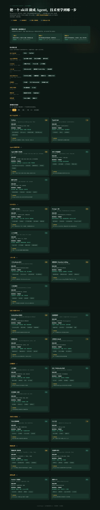

# CareerOS


> An operating system for your career growth. The skill is the recipe; the agent is the cook who can light the stove.

[](LICENSE)
[](CHANGELOG.md)
[](https://github.com/Duckweed-yhb/career-os-agent)

**English | [简体中文](README.md)**

---

## What this is

CareerOS gives you a route, not a course list: lock a target role → find the skill gaps against that role → close them with one real project → split the project into Markdown lessons you build through → end up with something you can put on a resume.

The repository holds two layers:

| Layer | What it is | Status |
|---|---|---|
| **Skill layer** | A single `SKILL.md` instruction with nine modules, loaded by your AI assistant | Available (v0.7.1) |
| **Agent layer** | The nine modules turned into tools, plus a runtime, long-term memory, proactive follow-up and a dashboard | Design stage — documents only |

How they divide the work: the skill settles the methodology, module boundaries and data discipline; the agent grows orchestration on top of that foundation, moving from "you type a command, it answers once" to "it knows what the next step is".

## Skill layer: install and use

1. Clone the repository (or download and extract it):

   ```bash
   git clone https://github.com/Duckweed-yhb/career-os-agent.git
   ```

2. Locate your AI assistant's skills directory:

   | Assistant | Skills directory |
   |---|---|
   | Claude Code | `~/.claude/skills/` |
   | Doubao Agent | `<workspace>/.skills/` |
   | Other assistants | See your assistant's documentation |

3. Put the whole repository inside a `career-os/` folder there — `templates/` and `examples/` are referenced by the skill automatically, so don't copy `SKILL.md` alone:

   ```bash
   # example (Claude Code)
   git clone https://github.com/Duckweed-yhb/career-os-agent.git ~/.claude/skills/career-os
   ```

   The assistant loads only `SKILL.md`, which is the Chinese core instruction. For English instructions, rename `SKILL.en.md` over it.

4. Restart your assistant session and verify:

   ```text
   /CareerOS init
   ```

   If you see the init welcome message, you are set.

## The nine modules

| # | Module | In one line |
|---|---|---|
| 1 | Target identification | Locks interests and background into 1–3 target roles, with a six-axis capability radar |
| 2 | Skill gaps | Role requirements against your self-assessment, ranked by impact × urgency |
| 3 | Project generator | Industrial-level projects aimed at the gaps; no toy projects |
| 4 | Course builder | The project split into learning-by-doing Markdown lessons, each with checkable acceptance criteria |
| 5 | Portfolio | Project → README guide + resume bullets + interview talking points |
| 6 | Resume review | Six-dimension scoring, issues tiered must-fix / should-fix / nice-to-have, with before → after rewrites |
| 7 | Mock test & interview | Timed questions scored one by one; interviews run one question at a time with feedback after each answer |
| 8 | Company intelligence | Interview flow, written-test style and pay, each fact carrying a source and a date; blanks stay blank |
| 9 | Full pipeline simulation | Apply → screening → written test → interview → outcome, with hard gates between stages |

Two modules need the network: `company` (company intelligence) and `simulate` (pipeline simulation). Offline they explicitly report "未查到公开信息" or fall back to generic role requirements — they never fabricate data.

## Common commands

```text
/CareerOS init
/CareerOS analyze [your resume or current skill list]
/CareerOS generate project --focus=[specific tech, e.g. Redis/microservices]
/CareerOS generate course [project]   # turn a chosen project into learning-by-doing lessons
/CareerOS review resume [resume]      # review your resume and find what to improve
/CareerOS mock interview [role]       # interview drill, one question at a time, with feedback
/CareerOS mock test [role]            # timed written-test practice with scoring
/CareerOS company [company] [role]    # research interview flow, test style and pay
/CareerOS simulate [company] [role]   # run the full pipeline: apply → screening → test → interview
```

For a full walkthrough see [examples/frontend-to-fullstack.md](examples/frontend-to-fullstack.md); for questions see the [FAQ](FAQ.en.md).

## Agent layer: what exists today

Design documents only, no code — deliberately, so the boundaries and trade-offs are settled before any implementation.

| Document | Content |
|---|---|
| [docs/agent/DESIGN.md](docs/agent/DESIGN.md) | Design doc: capability list, the four layers and one typical data flow, stack options, roadmap, and the Python prerequisites for building it yourself |

Five-stage roadmap:

| Stage | Goal | Status |
|---|---|---|
| 1 · Foundation | Runtime + intent parsing + unified contract + profile persistence | Not started |
| 2 · Port the tools | Positioning / gaps / projects / courses ported to tools, minimal loop working | Not started |
| 3 · Job-hunt loop | Resume review / mock test & interview / portfolio | Not started |
| 4 · Network & proactive | Company intel / pipeline simulation / cross-session memory / review prompts | Not started |
| 5 · Dashboard | Capability radar, learning progress, roadmap | Not started |

## Repository structure

```
career-os-agent/
├── SKILL.md / SKILL.en.md        # Skill core instructions (Chinese / English)
├── README.md / README.en.md      # This document (Chinese / English)
├── FAQ.md / FAQ.en.md            # FAQ
├── CONTRIBUTING.md / *.en.md     # Contribution guide
├── CODE_OF_CONDUCT.md / *.en.md  # Code of conduct
├── CHANGELOG.md / CHANGELOG.en.md
├── references/methodology.md     # Every scoring rule and data discipline
├── templates/                    # Domain templates: starting skeletons for projects and courses
├── examples/                     # Full conversation walkthrough + sample courses
├── assets/                       # Banner and social preview
├── docs/agent/DESIGN.md          # Design doc: capabilities, architecture, Python prerequisites
├── preview/                      # Tech-stack board (single HTML page)
└── .github/                      # CI verification script and issue templates
```

Docs are Chinese-first: the main file is Chinese, with an English twin using an `.en.md` suffix. Never mix two languages in one file.

## Design preview

`preview/career-os-agent-技术栈看板.html` answers one question: to turn a skill into an agent, how far does the tech have to go? Each item is anchored at Understand / Proficient / Mastery, with a concept list and one hands-on acceptance check.



## Repo history

This repo used to be called `career-os-skill`; it is now `career-os-agent`. The skill layer was already here, and the agent layer grows straight out of its nine modules. The old URL redirects, so existing clones keep working without touching their remote.

## License

[MIT License](LICENSE)

---

Made with ❤️ by Duckweed-yhb
