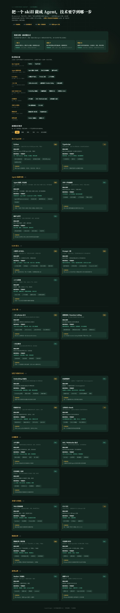

# CareerOS


> 一套为你的职业成长而设计的操作系统。Skill 是配方，Agent 是能自己开火做饭的厨师。

[](LICENSE)
[](CHANGELOG.md)
[](https://github.com/Duckweed-yhb/career-os-agent)

**[English](README.en.md) | 简体中文**

---

## 这是什么

CareerOS 给的是路线，不是课程清单：锁定目标岗位 → 对照岗位要求找出技能差距 → 用一个真实项目把差距补上 → 项目拆成 Markdown 课程，边做边学 → 攒成能写进简历的作品。

这个仓库装了两层东西：

| 层 | 是什么 | 状态 |
|---|---|---|
| **Skill 层** | 一份 `SKILL.md` 指令，九个模块，挂到 AI 助手里就能用 | 已可用（v0.7.1） |
| **Agent 层** | 把九个模块沉淀成工具集，加上运行时、长期记忆、主动跟进、可视化看板 | 规划阶段，目前只有文档 |

两层的分工：skill 把方法论、模块边界和数据纪律沉淀下来；agent 在这套地基上长出编排能力，从「你敲一条命令、它答一次」变成「它自己知道下一步该干什么」。

## Skill 层：装起来用

1. 克隆仓库（或下载后解压）：

   ```bash
   git clone https://github.com/Duckweed-yhb/career-os-agent.git
   ```

2. 找到你所用 AI 助手的 skills 目录：

   | 助手 | Skills 目录 |
   |---|---|
   | Claude Code | `~/.claude/skills/` |
   | 豆包 Agent | `<workspace>/.skills/` |
   | 其他助手 | 查阅对应助手的文档 |

3. 把整个仓库放进该目录下的 `career-os/` 文件夹——`templates/` 和 `examples/` 会被 Skill 自动引用，别只拷一份 `SKILL.md`：

   ```bash
   # 示例（Claude Code）
   git clone https://github.com/Duckweed-yhb/career-os-agent.git ~/.claude/skills/career-os
   ```

   助手只加载 `SKILL.md`，它是中文核心指令；想用英文指令就把 `SKILL.en.md` 改名替换过去。

4. 重启助手会话并验证：

   ```text
   /CareerOS init
   ```

   看到初始化欢迎语，就装好了。

## 九个模块

| # | 模块 | 一句话 |
|---|---|---|
| 1 | 目标定位 | 把兴趣和背景锁成 1–3 个目标岗位，出六维能力雷达 |
| 2 | 技能差距 | 岗位要求对用户自评，按「影响 × 紧迫度」排序缺口 |
| 3 | 项目生成 | 按缺口给工业级复杂度的项目，拒绝玩具项目 |
| 4 | 课程生成 | 把项目拆成边做边学的 Markdown 课程，每课都有可勾选的验收 |
| 5 | 作品集 | 项目 → README 指南 + 简历描述 + 面试讲法 |
| 6 | 简历评估 | 六维打分，按必修 / 建议 / 可选列问题，附「原文 → 改写」 |
| 7 | 模拟笔试面试 | 限时出题逐题打分；面试一次一问、每答反馈 |
| 8 | 公司情报 | 面试流程、笔试风格、薪资，每条带来源与时效，查不到就留空 |
| 9 | 招聘全流程 | 投简历 → 初筛 → 笔试 → 面试 → 结果，阶段硬门禁 |

两个模块依赖联网：`company`（公司情报）和 `simulate`（流程模拟）。离线环境下它们会明确标注「未查到公开信息」或改用岗位通用要求，不编造数据。

## 常用指令

```text
/CareerOS init
/CareerOS analyze [你的简历内容或当前技能列表]
/CareerOS generate project --focus=[具体技术点，如 Redis/微服务]
/CareerOS generate course [项目]   # 把选定项目拆成边做边学的课程
/CareerOS review resume [简历]     # 评估简历，找出还能完善的地方
/CareerOS mock interview [岗位]    # 一次一题的面试演练，带反馈
/CareerOS mock test [岗位]         # 限时笔试练习，带评分
/CareerOS company [公司] [岗位]    # 查证面试流程、笔试方向与薪资
/CareerOS simulate [公司] [岗位]   # 走一遍"投简历→初筛→笔试→面试"完整流程
```

完整对话示例见 [examples/frontend-to-fullstack.md](examples/frontend-to-fullstack.md)，常见问题见 [FAQ.md](FAQ.md)。

## Agent 层：现在有什么

只有设计文档，没有代码——这是有意的，先把边界和取舍定清楚再动手。

| 文档 | 内容 |
|---|---|
| [docs/agent/DESIGN.md](docs/agent/DESIGN.md) | 设计方案：能力清单、四层架构与数据流、技术栈选型、演进路线图，以及自己动手实现要先补到的 Python 门槛 |

五阶段路线图：

| 阶段 | 目标 | 状态 |
|---|---|---|
| 一 · 地基 | 运行时 + 意图理解 + 统一契约 + 档案持久化 | 未开始 |
| 二 · 工具平移 | 定位 / 差距 / 项目 / 课程 平移为 tools，跑通最小闭环 | 未开始 |
| 三 · 求职闭环 | 简历评估 / 模拟笔试面试 / 作品集 | 未开始 |
| 四 · 联网与主动 | 公司情报 / 全流程模拟 / 跨会话记忆 / 主动复盘 | 未开始 |
| 五 · 可视化 | 能力雷达、学习进度、路线图 | 未开始 |

## 目录结构

```
career-os-agent/
├── SKILL.md / SKILL.en.md        # Skill 核心指令（中 / 英）
├── README.md / README.en.md      # 本文档（中 / 英）
├── FAQ.md / FAQ.en.md            # 常见问题
├── CONTRIBUTING.md / *.en.md     # 贡献指南
├── CODE_OF_CONDUCT.md / *.en.md  # 行为准则
├── CHANGELOG.md / CHANGELOG.en.md
├── references/methodology.md / *.en.md  # 评分口径与数据纪律（雷达、校准、简历六维…）
├── templates/                    # 领域模板：项目与课程的起点骨架
├── examples/                     # 完整对话示例 + 课程样例
├── assets/                       # 仓库横幅与社交预览图
├── docs/agent/DESIGN.md / DESIGN.en.md  # 设计方案：能力 + 架构 + Python 先修
├── preview/                      # 技术栈看板（单页 HTML，浏览器直接打开）
└── .github/                      # CI 校验脚本与 issue 模板
```

文档语言规则：主文档一律中文，英文版同目录加 `.en.md` 后缀，一个文件不混用两种语言。`examples/` 与 `templates/` 是可复用的内容骨架，只提供中文。

## 设计预览

`preview/career-os-agent-技术栈看板.html` 回答一个问题：把一个 skill 做成 Agent，技术要学到哪一步。按「了解 / 熟练 / 精通」三级锚定，逐项给概念清单和可验证的实操验收。



## 仓库沿革

本仓库原名 `career-os-skill`，现更名为 `career-os-agent`——skill 层原本就在这里，Agent 层直接从它的九大模块长出来。旧地址会自动重定向，已有的克隆不改 remote 也能继续拉。

## 许可证

[MIT License](LICENSE)

---

Made with ❤️ by Duckweed-yhb
